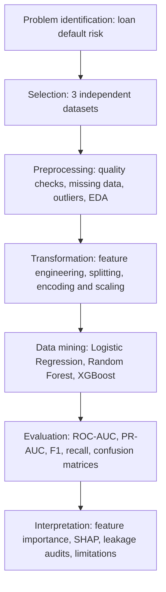
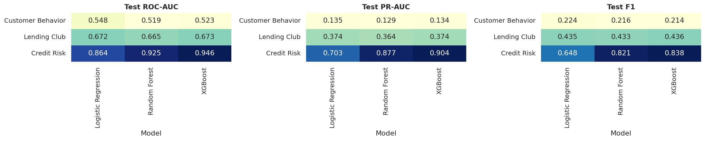
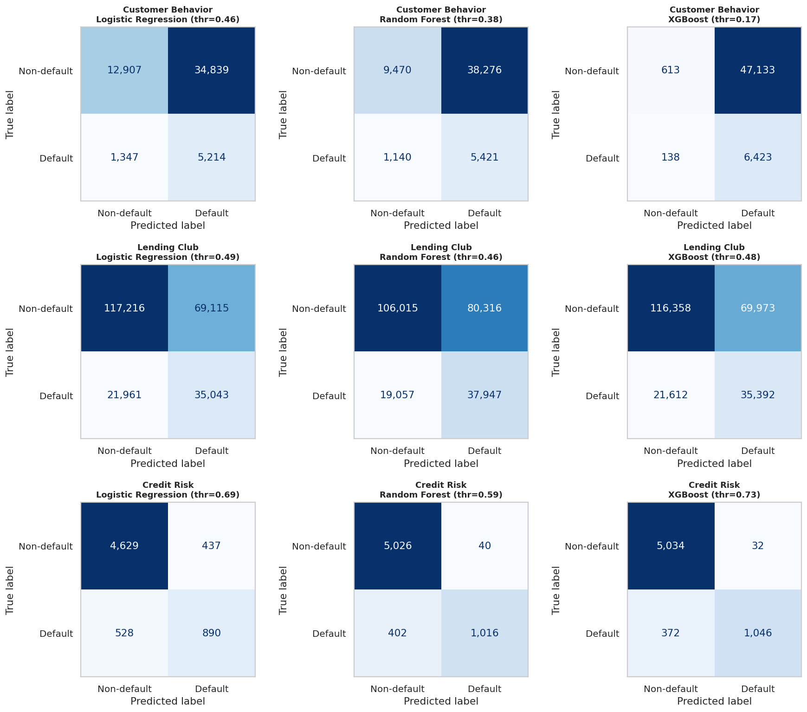
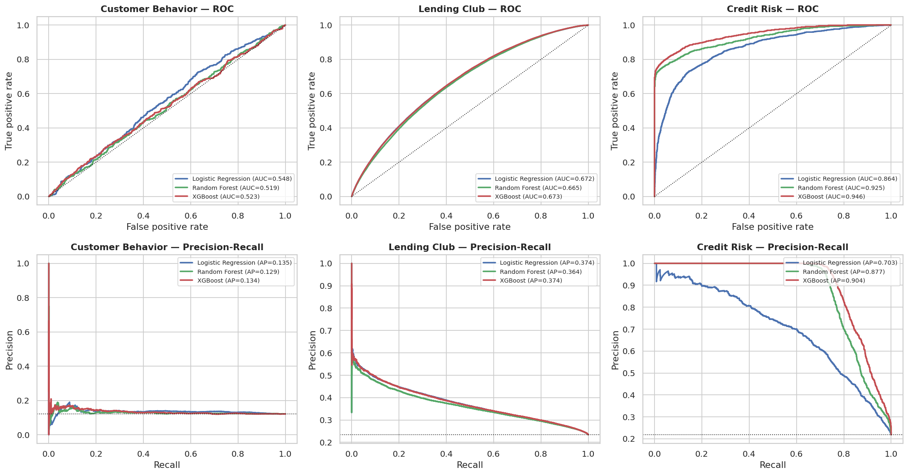
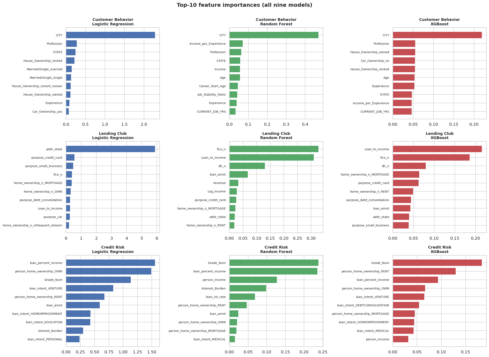
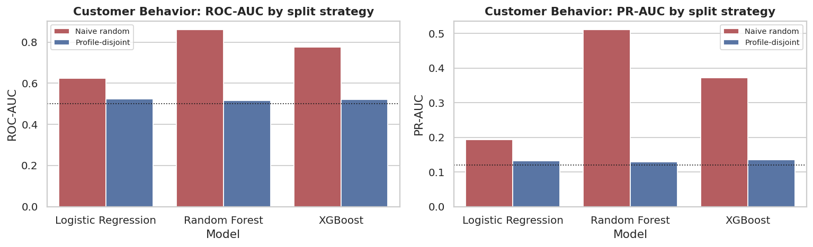

# Loan Default Prediction Using Machine Learning
## A Comparative Multi-Dataset Study Based on KDD Methodology

**Course:** Predictive Analytics — CA3 &nbsp;
**Environment:** Python / Google Colab / Jupyter Notebook


---

## Abstract

This notebook studies loan-default prediction on **three independent datasets** — *Customer Behavior* (`Risk_Flag`), *Lending Club* (`Default`) and *Credit Risk* (`loan_status`). The datasets are **never merged**: each has its own target definition, population and leakage risks, so each is processed, modelled and evaluated separately and the results are compared only at the level of *methodology and metrics*.

Three model families — **Logistic Regression, Random Forest and XGBoost** — are trained on every dataset (**3 × 3 = 9 models**), tuned with cross-validated randomized search, and evaluated on held-out data with Accuracy, Precision, Recall, F1, ROC-AUC, PR-AUC, confusion matrices and ROC / precision-recall curves.

---

## Table of Contents

1. [Problem Statement](#1-problem-statement)
2. [Objectives](#2-objectives)
3. [Datasets](#3-datasets)
4. [KDD Methodology & Workflow](#4-kdd-methodology-and-workflow)
5. [Models & Evaluation](#5-models-and-evaluation)
6. [Visual Results](#6-visual-results-actual-notebook-output)
7. [How to Run](#7-how-to-run)
8. [Repository Structure](#8-repository-structure)
9. [Interpretation & Limitations](#9-interpretation-and-limitations)
10. [Conclusion](#10-conclusion)
11. [References](#11-references)

---

## 1. Problem Statement

Loan default prediction is a binary classification problem in credit-risk analysis. This project studies whether machine-learning models can identify higher-risk applicants or loans from available applicant and loan attributes. It compares the same modelling approach across three **independent** datasets. Because the datasets differ in population, feature availability and target definition, their records are **not combined** and scores are not treated as a head-to-head comparison on identical data.

---

## 2. Objectives

- Apply the five stages of **Knowledge Discovery in Databases (KDD)**.
- Explore and preprocess three loan/credit-risk datasets **independently**.
- Build and compare **Logistic Regression, Random Forest and XGBoost** (nine dataset–model combinations).
- Evaluate models using classification metrics and visual diagnostics.
- Interpret predictions and examine possible **data leakage** and generalization limits.

---

## 3. Datasets

| Dataset | Source | Input file | Target | Approx. original rows |
|---|---|---|---|---:|
| Customer Behavior | [Kaggle](https://www.kaggle.com/datasets/subhamjain/loan-prediction-based-on-customer-behavior) | `Training Data.csv` | `Risk_Flag` | 252,000 |
| Lending Club | [Zenodo](https://zenodo.org/records/11295916) | `LC_loans_granting_model_dataset.csv` | `Default` | 1,347,681 |
| Credit Risk | [Kaggle](https://www.kaggle.com/datasets/laotse/credit-risk-dataset) | `credit_risk_dataset.csv` | `loan_status` | 32,581 |

See [`datasets/README.md`](datasets/README.md) for download instructions. The three targets are dataset-specific proxies for loan or borrower risk and should **not** be assumed to have identical operational meanings.

---

## 4. KDD Methodology and Workflow



| KDD stage | Where in this notebook | Main activities |
|---|---|---|
| **1. Selection** | Section 1 | Locate/load files, validate targets, document which columns are kept or dropped and why |
| **2. Preprocessing** | Section 2 | Missing values, duplicates, implausible values, outliers, label-maturity check, class distribution, EDA |
| **3. Transformation** | Section 3 | Feature engineering, leakage-safe splitting, encoding, outlier clipping, imputation, scaling |
| **4. Data Mining** | Section 4 | Baseline models, hyper-parameter tuning, class-imbalance handling, final training of 9 models |
| **5. Evaluation / Interpretation** | Section 5 | Validation-based selection, held-out test results, curves, bootstrap CIs, importance, SHAP, leakage audits |
| *Knowledge use* | Sections 6–8 | Interactive widget interface, export, conclusions, limitations, future scope |

---

## 5. Models and Evaluation

Three algorithms are evaluated on each dataset, producing **nine model evaluations**. The notebook uses a train/validation/test approach, randomized hyperparameter search, and a dataset-appropriate holdout strategy (including a chronological approach for Lending Club).

**Metrics:** Accuracy, Precision, Recall, F1-score, ROC-AUC, PR-AUC, confusion matrices, ROC curves and precision–recall curves. Model selection is based on validation PR-AUC, with decision thresholds separately tuned using validation data.

### Selected Models — Held-out Test Results (threshold = 0.5)

| Dataset | Selected Model | Accuracy | ROC-AUC | PR-AUC |
|---|---|---:|---:|---:|
| Customer Behavior | XGBoost | 57.14% | 0.523 | 0.134 |
| Lending Club | XGBoost | 64.76% | 0.673 | 0.374 |
| Credit Risk | XGBoost | 92.38% | 0.946 | 0.904 |

> The notebook also reports metrics with **validation-tuned thresholds**, which can produce substantially different accuracy, recall and F1 scores. See [`results/test_results_tuned_threshold.csv`](results/test_results_tuned_threshold.csv) for those results.

---

## 6. Visual Results (Actual Notebook Output)

> **Note:** These are real exported plots from the notebook run, not placeholders.

### 6.1 Model Performance Heatmaps



### 6.2 Confusion Matrices



### 6.3 ROC and Precision–Recall Curves



### 6.4 Feature Importance



### 6.5 Customer Behavior Split / Leakage Audit



---

## 7. How to Run

1. Open [`Loan_Default_Prediction_KDD_CA3.ipynb`](Loan_Default_Prediction_KDD_CA3.ipynb) in [Google Colab](https://colab.research.google.com/) (or click the **Open in Colab** badge above).
2. Download the three CSVs using the instructions in [`datasets/README.md`](datasets/README.md).
3. Upload the CSVs to Colab when prompted, **or** store them in Google Drive and set `MOUNT_DRIVE = True` and update `DATA_DIR` in the notebook.
4. Run the notebook from top to bottom (**Runtime → Run all**). Training and tuning may take time, particularly on Lending Club (~20–45 minutes on a free CPU runtime).
5. Set `QUICK_MODE = True` in the configuration cell for a fast smoke test (smaller samples, fewer search iterations — results will differ).
6. Review the generated tables, plots, leakage audits and interactive prediction interface.


### Dependencies

Install dependencies locally (if not using Colab):

```bash
pip install -r requirements.txt
```

Key packages: `numpy`, `pandas`, `matplotlib`, `seaborn`, `scikit-learn`, `xgboost`, `shap`, `ipywidgets`.

---

## 8. Repository Structure

```text
Loan-Default-Prediction-KDD/
├── Loan_Default_Prediction_KDD_CA3.ipynb   ← Main notebook (with saved outputs)
├── README.md
├── requirements.txt
├── .gitignore
├── datasets/
│   └── README.md                           ← Dataset download instructions
├── results/
│   ├── model_selection.csv                 ← Val-based model selection table
│   ├── split_summary.csv                   ← Train/val/test split sizes
│   ├── test_results_threshold_0.5.csv      ← Held-out results at 0.5 threshold
│   └── test_results_tuned_threshold.csv    ← Held-out results at tuned threshold
└── figures/
    ├── 04_feature_importance_all_models.png
    ├── 05_audit_customer_split.png
    ├── 05_confusion_matrices.png
    ├── 05_roc_pr_curves.png
    └── 05_test_metric_heatmaps.png
```

---

## 9. Interpretation and Limitations

- **Customer Behavior:** discrimination on held-out customer profiles is weak (ROC-AUC ≈ 0.52 for selected XGBoost). This is important to report rather than conceal; the notebook includes a customer split/leakage audit.
- **Lending Club:** moderate predictive discrimination. Results depend on loan issue dates, label maturity, dataset selection and available features.
- **Credit Risk:** comparatively strong results, but features such as loan grade and interest rate may not be available at every real-world decision point. The notebook includes a leakage sensitivity audit.
- The datasets differ in target semantics, prevalence and population, so the results **do not** establish that one dataset or lending population is inherently easier or harder.
- These are academic experiments, **not** a production lending decision system; deployment would require external validation, fairness review, calibration, and monitoring.

---

## 10. Conclusion

The project demonstrates an end-to-end KDD workflow for loan-default risk prediction, from selecting and understanding data to training, evaluating and interpreting predictive models. The results show that:

- Performance varies substantially by dataset and target definition.
- XGBoost consistently achieves the best validation PR-AUC across all three datasets.
- Leakage checks and appropriate validation are essential to trustworthy predictive analytics.
- Threshold tuning can substantially improve recall at the cost of precision, making it a critical step for imbalanced credit-risk tasks.

---

## 11. References

- [Loan Prediction Based on Customer Behavior — Kaggle](https://www.kaggle.com/datasets/subhamjain/loan-prediction-based-on-customer-behavior)
- [Lending Club dataset — Zenodo](https://zenodo.org/records/11295916)
- [Credit Risk Dataset — Kaggle](https://www.kaggle.com/datasets/laotse/credit-risk-dataset)
- [scikit-learn documentation](https://scikit-learn.org/stable/)
- [XGBoost documentation](https://xgboost.readthedocs.io/)
- [SHAP documentation](https://shap.readthedocs.io/)
- Fayyad, U., Piatetsky-Shapiro, G., & Smyth, P. (1996). *From Data Mining to Knowledge Discovery in Databases.* AI Magazine, 17(3), 37–54.

---

